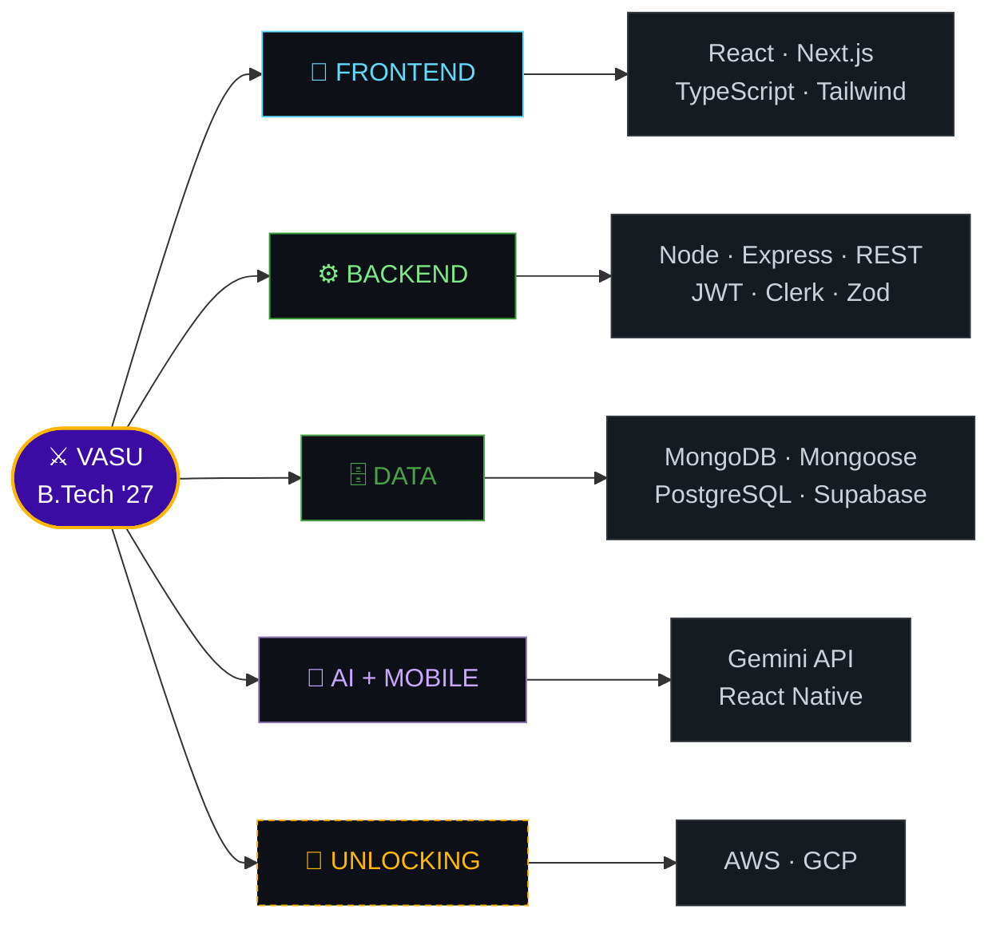

<div align="center">


<a href="https://github.com/VasuDreamDebugger">
  
</a>

<br/>

<a href="https://www.linkedin.com/in/vasu-manikanta-274a26303"></a>
<a href="https://leetcode.com/u/manikanta_vasu/"></a>
<a href="mailto:vasumanikanta352@gmail.com"></a>


</div>

<br/>

## 📜 Prologue: The Character Sheet

> *Every great build starts with a spark. Mine started with "how does this actually work?" and never stopped.*

```text
╔════════════════════════════════════════════════════════════╗
║  PLAYER    Manikanta Vasu Kottapalli  (call me Vasu)       ║
║  CLASS     Full Stack Engineer  ·  Subclass: MERN Artificer║
║  HOME      Vijayawada, Andhra Pradesh                      ║
║  ACADEMY   RGUKT Ongole  ·  B.Tech CSE  ·  CGPA 9.0        ║
║  GUILD     SmushLabs  ·  Frontend Developer Intern         ║
║  LOOKING   Internships · Collabs · Hard, interesting bugs  ║
╠════════════════════════════════════════════════════════════╣
║  FRONTEND  ██████████░  React · Next.js · TypeScript       ║
║  BACKEND   █████████░░  Node · Express · REST · JWT        ║
║  DATABASE  ████████░░░  MongoDB · PostgreSQL               ║
║  MOBILE    ██████░░░░░  React Native                       ║
║  CLOUD     ███░░░░░░░░  AWS · GCP  (levelling up...)       ║
╚════════════════════════════════════════════════════════════╝
```

**Player philosophy:** I like owning a feature from the API contract to the last pixel of the UI, writing code that's strongly typed and easy to extend, and chasing a bug across the whole stack until it gives up. I work with AI as a teammate, not a crutch.

<br/>

## 🌳 Chapter I: The Skill Tree



### ⚔️ Main Class: MERN

<p>
  
  
  
  
</p>

### 🗡️ Weapons (Languages)

<p>
  
  
  
  
</p>

### 🛡️ Armor (Frontend & Mobile)

<p>
  
  
  
  
  
</p>

### 🧪 Potions (Backend, Data & Auth)

<p>
  
  
  
  
  
  
  
</p>

### 🎒 Inventory (Tools)

<p>
  
  
  
  
</p>

### 🐉 Familiars (AI-Native Workflow)

<p>
  
  
  
</p>

### 🔮 Unlocking Next

<p>
  
  
</p>

<br/>

## 🗺️ Chapter II: The Journey So Far

```text
  [2021–23]  The Awakening      ──▶  RGUKT Kadapa · Intermediate (MPC) · CGPA 9.8
      │
  [2023–27]  The Academy        ──▶  RGUKT Ongole · B.Tech CSE · CGPA 9.0
      │
  [Mar–May 2026]  First Guild  ──▶  SmushLabs · Frontend Developer Intern
      │
  [NOW]  Side quests & boss fights ──▶  SkillChaser · FinPilot · always shipping
```

<details open>
<summary><b>🏰 Guild Quest: SmushLabs (Frontend Developer Intern, Mar to May 2026)</b></summary>

<br/>

> **Quest:** build **SmushChat**, a SaaS product for AI chatbot services.

| 🎁 Loot | Details |
|---|---|
| **Strongly typed UI** | Built the app in TypeScript + React + Tailwind so bugs get caught early and the codebase stays easy to extend |
| **Component library** | Created reusable React components so the team could launch new feature pages much faster without rewriting core code |
| **Speed + SEO** | WebP image compression and `react-helmet-async` meta tags for faster loads and more organic traffic |

[](https://github.com/SmushLabs/SmushChat-Landing)

</details>

<br/>

## 🐲 Chapter III: Boss Fights (Projects)

<table>
<tr>
<td width="50%" valign="top">

### 🎓 SkillChaser
**AI-powered Learning Management System**

Turns a student's goals, availability and deadlines into day-by-day roadmaps, structured curricula and YouTube lecture picks.

- Gemini + **Zod** pipeline: prompt-driven curriculum generation with runtime schema validation, so malformed AI output never reaches MongoDB
- Cuts manual study planning time by **85%**
- Role-based student / educator dashboards, interactive video lessons, progress tracking, rich-text course creation

    

[🔴 Live Demo](https://skill-chaser-frontend.vercel.app/) · [📂 Source](https://github.com/VasuDreamDebugger/SkillChaser)

</td>
<td width="50%" valign="top">

### 💸 FinPilot
**Smart personal finance and insights (mobile)**

Expense tracking, budgets, **voice-based transaction logging** and **receipt scanning**, all in your pocket.

- Gemini extracts transactions from voice and receipts at **~93% field-level accuracy**, cutting entry time by **~65%**
- Zustand + TanStack Query cut redundant DB requests by **~40%**
- Auth with Clerk, data on Supabase PostgreSQL

    

[📂 Source](https://github.com/VasuDreamDebugger/Welth)

</td>
</tr>
</table>

<div align="center">

<a href="https://github.com/VasuDreamDebugger/SkillChaser"></a>
<a href="https://github.com/VasuDreamDebugger/Welth"></a>
<a href="https://github.com/SmushLabs/SmushChat-Landing"></a>

</div>

<br/>

## 📊 Chapter IV: Battle Stats (Live)

<div align="center">


</div>

<br/>

## 🏟️ Chapter V: The Training Arena (LeetCode)

<div align="center">

<a href="https://leetcode.com/u/manikanta_vasu/">
  
</a>

</div>

<br/>

## 🏆 Chapter VI: Achievements

<div align="center">
  
</div>

| 🏅 Badge | Unlocked |
|---|---|
| **React.js** | NxtWave Verified Credential: hooks, component architecture, state handling, performance basics |
| **JavaScript** | NxtWave Verified Credential: ES6+, DOM, async operations, the Event Loop |
| **Academic** | CGPA 9.8 (Intermediate) → 9.0 (B.Tech, ongoing) |

<br/>

## 🎯 Current Quest Log

- [x] Ship **SkillChaser** and **FinPilot**
- [x] Complete a frontend internship at **SmushLabs**
- [ ] Level up in **AWS** and **GCP**
- [ ] Take **React Native** from "built it" to "mastered it"
- [ ] Land the next guild: internships and full-stack roles

<br/>

## 📮 Final Chapter: Join My Party

> *Got a quest, a bug nobody wants to touch, or an idea that sounds slightly impossible? Send a raven.*

<div align="center">

<a href="https://www.linkedin.com/in/vasu-manikanta-274a26303"></a>
<a href="mailto:vasumanikanta352@gmail.com"></a>
<a href="https://github.com/VasuDreamDebugger"></a>
<a href="https://leetcode.com/u/manikanta_vasu/"></a>


</div>
